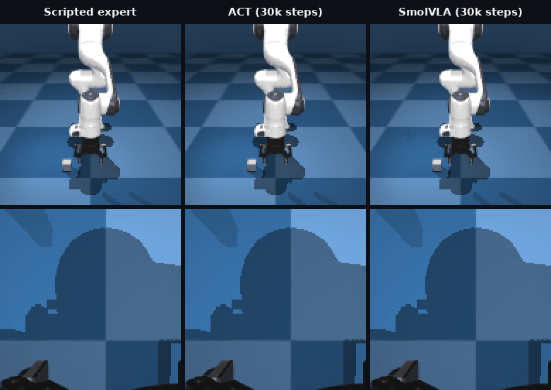
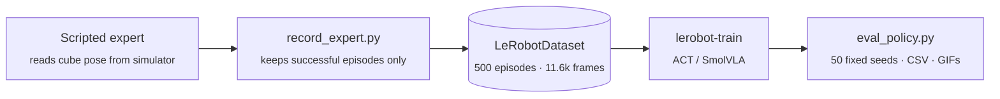

<div align="center">

# ACT vs SmolVLA: Learning to Pick Up a Cube

**Imitation learning on a simulated Franka Panda arm, comparing a compact transformer policy (ACT)
with a 450M-parameter vision-language-action model (SmolVLA).**

Built with [LeRobot](https://github.com/huggingface/lerobot) · [gym-hil](https://github.com/huggingface/gym-hil) · MuJoCo



<sub>The same cube position (seed 1000), three controllers. Top row: front camera. Bottom row: wrist camera. Both learned policies see only these two 128×128 images and the robot's joint state.</sub>

</div>

---

## Highlights

- **End-to-end pipeline**: scripted expert → 500 recorded demonstrations → policy training → seeded evaluation with confidence intervals.
- **Both policies reach 92–94% success** on 50 fixed test positions, close to the scripted expert's 100%.
- **ACT trains about 25× faster** (~25 min vs ~10 h on a laptop RTX 4070) and matches SmolVLA on this single-task setup.
- **Every number is reproducible**: fixed evaluation seeds, per-episode CSVs, and rollout GIFs for each checkpoint in [`eval_results/`](eval_results).

## Results

<picture>
  <source media="(prefers-color-scheme: dark)" srcset="assets/success_curve_dark.png">
  
</picture>

| Policy | Trainable params | Best checkpoint | Success (≥ 5 cm lift) | 95% CI | Training time |
|---|---|---|---|---|---|
| Scripted expert | – | – | 20 / 20 (100%) | 84–100% | – |
| **ACT** | 52M | 25k steps | **47 / 50 (94%)** | 84–98% | ~25 min |
| **SmolVLA** | 100M of 450M | 25k steps | **47 / 50 (94%)** | 84–98% | ~10 h |

At 30k steps ACT holds 94% and SmolVLA scores 92%. The confidence intervals overlap almost completely, so
**on this task the two are statistically tied**. Their failures look alike: the policy never picks the cube up, and the episode runs out of time.

<details>
<summary><b>What a failure looks like</b></summary>
<br>
<div align="center">

</div>

The gripper action is applied as an increment (each step adds `action − 1` to the gripper's closure level).
Near the grasp, ACT outputs values just above 1 that add up, so the gripper shuts before it reaches the cube.
To reopen, it would need values well below 1, so the policy cannot recover.
</details>

## How it works



**Task.** `gym_hil` Panda pick-cube: the cube spawns at a random position in a 20 × 30 cm patch, and the robot must lift it.
Control runs at 10 Hz with a 4-D action `[dx, dy, dz, gripper]`.

**Demonstrations.** [`scripted_expert.py`](scripted_expert.py) is a phase-based controller (hover → descend → close → lift)
that reads the cube's true position from the simulator. Its actions use the same format as keyboard teleoperation, so the
dataset is interchangeable with human-recorded data. The recorded data holds only what a real robot would have:

| Observation | Shape |
|---|---|
| Front camera | 3 × 128 × 128 |
| Wrist camera | 3 × 128 × 128 |
| Robot state (joint pos/vel, gripper, end-effector position) | 18 |

**Policies.**
- **ACT** (Action Chunking Transformer), trained from scratch. Batch 16, lr 1e-5, chunks of 10 actions.
- **SmolVLA**, fine-tuned from [`lerobot/smolvla_base`](https://huggingface.co/lerobot/smolvla_base). The vision encoder is frozen and only the action expert is trained. Batch 16, lr 1e-4, chunks of 10 actions. Instruction: `"pick_cube"`.

**Evaluation.** [`eval_policy.py`](eval_policy.py) runs each checkpoint on seeds 1000–1049. These set the cube positions, so every
policy faces exactly the same 50 cubes. An episode counts as a success if the cube rises at least 5 cm within 100 steps. The environment's own
10 cm rule is recorded alongside it. Success rates come with Wilson 95% confidence intervals.

## Repository layout

```
.
├── scripted_expert.py      # privileged scripted controller that generates the demos
├── record_expert.py        # records expert episodes as a LeRobotDataset
├── eval_policy.py          # seeded evaluation for ACT, SmolVLA or the expert
├── test_expert.py          # quick success-rate check of the expert
├── run_after_training.sh   # waits for training, evaluates every checkpoint, builds a curve
├── configs/                # gym_manipulator configs for keyboard teleop recording
├── eval_results/           # per-seed CSVs, summary JSONs and rollout GIFs for every run
├── logs/                   # training and evaluation logs
├── assets/                 # figures used in this README
└── tools/
    ├── make_readme_media.py   # rebuilds the README figures from eval_results/
    ├── view_episode.py        # renders a dataset episode to a GIF
    └── smoke.py               # MuJoCo install check
```

## Reproduce

**Setup.** Python 3.12, LeRobot at commit [`200ee535`](https://github.com/huggingface/lerobot/commit/200ee535), and `gym-hil==0.1.14`.

```bash
git clone https://github.com/huggingface/lerobot.git && (cd lerobot && git checkout 200ee535 && pip install -e ".[smolvla]")
pip install gym-hil==0.1.14
```

**1. Record demonstrations**
```bash
python test_expert.py 20                                   # expert sanity check
python record_expert.py --repo-id local/franka_expert_v2 --episodes 500
```

**2. Train** (key flags only)
```bash
lerobot-train --policy.type=act --dataset.repo_id=local/franka_expert_v2 \
  --batch_size=16 --steps=30000 --output_dir=outputs/train/act_v2_30k

lerobot-train --policy.path=lerobot/smolvla_base --dataset.repo_id=local/franka_expert_v2 \
  --batch_size=16 --steps=30000 --output_dir=outputs/train/smolvla_v2_30k \
  --rename_map='{"observation.images.front": "observation.images.camera1", "observation.images.wrist": "observation.images.camera2"}'
```
These show the key flags. The exact configuration of each run is printed at the top of its log in [`logs/`](logs).

**3. Evaluate**
```bash
python eval_policy.py --expert --episodes 20 --name expert

python eval_policy.py --name act_30k --episodes 50 \
  --checkpoint outputs/train/act_v2_30k/checkpoints/030000/pretrained_model \
  --repo-id local/franka_expert_v2

python eval_policy.py --name smolvla_30k --policy-type smolvla --episodes 50 \
  --checkpoint outputs/train/smolvla_v2_30k/checkpoints/030000/pretrained_model
```

**4. Rebuild the README figures**
```bash
python tools/make_readme_media.py
```

## Next steps

- **Data efficiency**: train on 25 / 50 / 100 / 200 demos to test whether SmolVLA's pretraining helps when data is scarce.
- **Language conditioning**: add differently colored cubes and instructions like "pick the red cube", which ACT cannot follow.
- **Robustness**: distractor objects, lighting changes, and cube positions outside the training patch.

## Acknowledgements

[LeRobot](https://github.com/huggingface/lerobot) for the ACT and SmolVLA implementations and training stack,
[gym-hil](https://github.com/huggingface/gym-hil) for the Franka simulation, and
[MuJoCo](https://mujoco.org) for physics.
