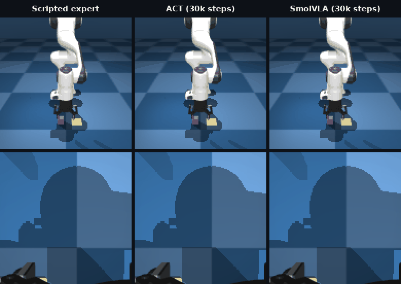
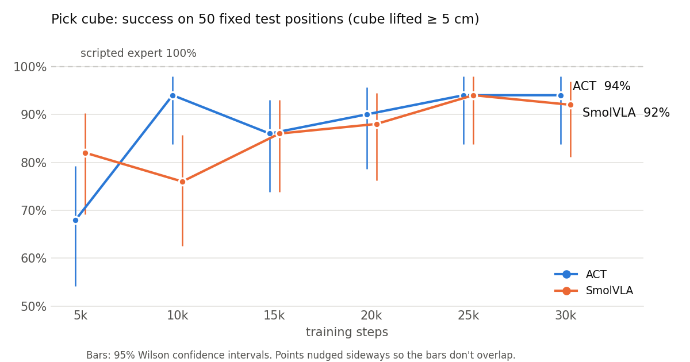
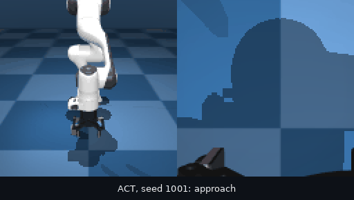
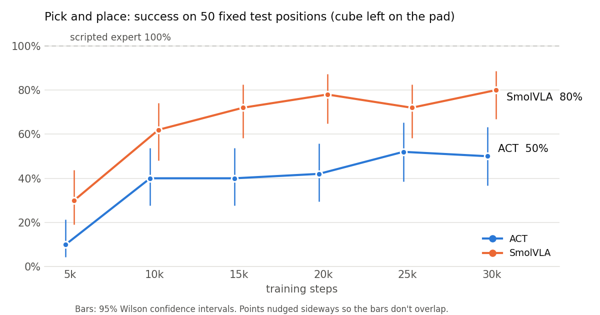
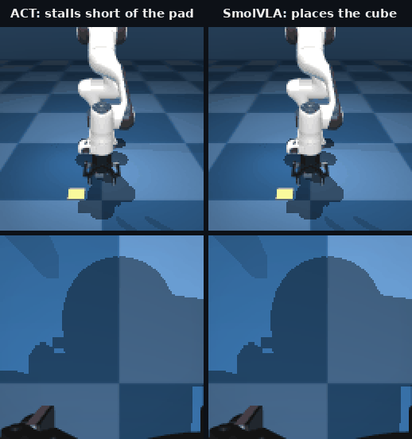
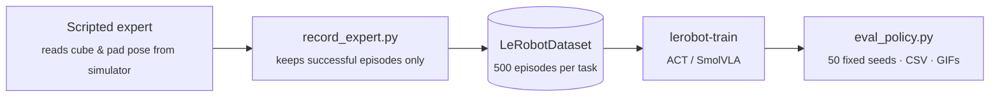

<div align="center">

# ACT vs SmolVLA: Imitation Learning for Robot Manipulation

**Teaching a simulated Franka Panda arm to pick up a cube and place it on a target, and comparing a compact
transformer policy (ACT) with a 450M-parameter vision-language-action model (SmolVLA).**

Built with [LeRobot](https://github.com/huggingface/lerobot) · [gym-hil](https://github.com/huggingface/gym-hil) · MuJoCo



<sub>Pick and place, same cube and pad position (seed 1011), three controllers. Top row: front camera. Bottom row: wrist camera.
The learned policies see only these two 128×128 images and the robot's joint state.</sub>

</div>

---

## Highlights

- **Two tasks, one pipeline**: scripted expert → 500 demonstrations → policy training → evaluation on 50 fixed seeds with confidence intervals.
- **Custom pick-and-place task** built on top of gym-hil in MuJoCo: a yellow target pad, randomized cube and pad positions, and success checks that confirm the cube was placed and released.
- **The VLA pulls ahead on the harder task.** Both policies reach 94% on pick-up, but on pick-and-place **SmolVLA reaches 80% vs ACT's 50%**, with non-overlapping 95% confidence intervals.
- **Failure analysis from rollouts**: ACT loses most of its pick-and-place episodes *after* the grasp, by stalling short of the pad or never releasing (16 of 25 failures, vs 2 of 10 for SmolVLA).
- **Fully reproducible**: per-episode CSVs, summary JSONs and rollout GIFs for every checkpoint are in [`eval_results/`](eval_results).

## Results at a glance

| Task | ACT (52M, from scratch) | SmolVLA (450M, fine-tuned) | Scripted expert |
|---|---|---|---|
| Pick cube | **94%** (47/50) | **94%** (47/50) | 100% |
| Pick and place | 50% (25/50) | **80%** (40/50) | 100% |
| Training time, 30k steps (laptop RTX 4070) | ~25 min | ~7–10 h | – |

Best checkpoint shown for pick cube (25k for both). Final 30k checkpoint shown for pick and place.

---

## Task 1: Pick up the cube

The cube spawns at a random spot in a 20 × 30 cm area. An episode succeeds if the cube is lifted at least 5 cm within 100 steps.

<picture>
  <source media="(prefers-color-scheme: dark)" srcset="assets/success_curve_dark.png">
  
</picture>

| Policy | Best checkpoint | Success | 95% CI |
|---|---|---|---|
| Scripted expert | – | 20 / 20 (100%) | 84–100% |
| ACT | 25k | 47 / 50 (94%) | 84–98% |
| SmolVLA | 25k | 47 / 50 (94%) | 84–98% |

On this task the two policies are **statistically tied**.

<details>
<summary><b>What a pick-cube failure looks like</b></summary>
<br>
<div align="center">

</div>

The gripper action is applied as an increment: each step adds `action − 1` to the gripper's closure level.
Near the grasp, ACT outputs values just above 1 that add up, so the gripper shuts before it reaches the cube.
To reopen, it would need values well below 1, so the policy cannot recover.
</details>

## Task 2: Pick and place

A 7 × 7 cm yellow pad is added to the scene ([`pick_place_env.py`](pick_place_env.py)). Each episode puts the cube (4 cm)
and the pad at random positions at least 10 cm apart, so the policy has to find both in the camera images.

**Success** means the cube rests inside the pad, the gripper is open, and the gripper has backed off at least 4 cm above the
cube, all held for 3 steps. This makes the release part of the task: holding the cube over the pad, or dropping it
next to the pad, doesn't count. Episodes are limited to 150 steps, and the scripted expert needs about 43.

<picture>
  <source media="(prefers-color-scheme: dark)" srcset="assets/pickplace_curve_dark.png">
  
</picture>

| Policy | Checkpoint | Success | 95% CI | Avg. steps when successful |
|---|---|---|---|---|
| Scripted expert | – | 50 / 50 (100%) | 93–100% | 43 |
| ACT | 30k (best: 25k, 52%) | 25 / 50 (50%) | 37–63% | 61 |
| **SmolVLA** | **30k** | **40 / 50 (80%)** | **67–89%** | **50** |

**Where the policies fail** (30k checkpoints):

| Outcome | ACT | SmolVLA |
|---|---|---|
| Placed on the pad | 25 | 40 |
| Never picked the cube up | 9 | 8 |
| Picked it up, then failed to place it | **16** | **2** |

Both policies miss the grasp about equally often. The gap is in the carry-and-place part: once ACT has the cube, it often
stalls partway, repeating nearly the same action until time runs out. SmolVLA moves through the stages cleanly.

<div align="center">


<sub>Seed 1002. Left: ACT sets the cube down about 12 cm short of the pad and freezes, even though the pad is visible ahead in the wrist camera.
Right: SmolVLA places the cube on the pad in 43 steps.</sub>
</div>

---

## How it works



**Environment.** gym-hil's Franka Panda with a Robotiq gripper in MuJoCo. Control runs at 10 Hz with a 4-D action
`[dx, dy, dz, gripper]`. The pick-and-place scene adds the pad as a non-colliding static body and moves it each episode,
without modifying gym-hil.

**Demonstrations.** [`scripted_expert.py`](scripted_expert.py) holds two phase-based controllers that read object positions
from the simulator:
- `PickCubeExpert`: hover → descend → close → lift.
- `PickPlaceExpert`: the same grasp, then carry → lower → open → retreat.

Their actions use the same format as keyboard teleoperation. The recorded data holds only what a real robot would have:

| Observation | Shape |
|---|---|
| Front camera | 3 × 128 × 128 |
| Wrist camera | 3 × 128 × 128 |
| Robot state (joint pos/vel, gripper, end-effector position) | 18 |

| Dataset | Episodes | Frames | Seeds |
|---|---|---|---|
| `franka_expert_v2` (pick cube) | 500 | 11.6k | random |
| `franka_pickplace_v1` (pick and place) | 500 | 21.4k | 100000–100499 |

**Policies.**
- **ACT** (Action Chunking Transformer), 52M parameters, trained from scratch. Batch 16, lr 1e-5, chunks of 10 actions.
- **SmolVLA**, 450M parameters, fine-tuned from [`lerobot/smolvla_base`](https://huggingface.co/lerobot/smolvla_base). The vision encoder is frozen and only the action expert is trained (100M parameters). Batch 16, lr 1e-4, chunks of 10 actions.
  Instructions: `"pick_cube"` and `"pick up the cube and place it on the yellow pad"`.

**Evaluation.** [`eval_policy.py`](eval_policy.py) runs each checkpoint on seeds 1000–1049. These set the cube (and pad) positions,
so every policy faces exactly the same 50 scenes, none of which were in the training data. Success rates come with Wilson 95% confidence intervals.

## Repository layout

```
.
├── pick_place_env.py           # pick-and-place environment (gym-hil scene + target pad)
├── scripted_expert.py          # scripted controllers for both tasks
├── record_expert.py            # records expert episodes as a LeRobotDataset (--env pick_cube | pick_place)
├── eval_policy.py              # seeded evaluation for ACT, SmolVLA or the expert (--env pick_cube | pick_place)
├── test_expert.py              # success rate of the pick-cube expert
├── test_pick_place.py          # success rate of the pick-and-place expert
├── run_after_training.sh       # pick cube: evaluates every checkpoint after training
├── run_pickplace_overnight.sh  # pick and place: record → train ACT → eval → train SmolVLA → eval, unattended
├── configs/                    # gym_manipulator configs for keyboard teleop recording
├── eval_results/               # per-seed CSVs, summary JSONs and rollout GIFs for every run
├── logs/                       # recording, training and evaluation logs
├── assets/                     # figures used in this README
└── tools/
    ├── make_readme_media.py    # rebuilds the README figures from eval_results/
    ├── view_episode.py         # renders a dataset episode to a GIF
    └── smoke.py                # MuJoCo install check
```

## Reproduce

**Setup.** Python 3.12, LeRobot at commit [`200ee535`](https://github.com/huggingface/lerobot/commit/200ee535), and `gym-hil==0.1.14`.

```bash
git clone https://github.com/huggingface/lerobot.git && (cd lerobot && git checkout 200ee535 && pip install -e ".[smolvla]")
pip install gym-hil==0.1.14
```

**Pick and place, end to end** (about 8 hours on a laptop RTX 4070):
```bash
python test_pick_place.py 20                      # expert sanity check
python record_expert.py --env pick_place --repo-id local/franka_pickplace_v1 --episodes 500
./run_pickplace_overnight.sh                      # trains and evaluates both policies; see logs/pickplace_overnight.log
```
The script contains the exact `lerobot-train` commands used.

**Pick cube**
```bash
python record_expert.py --repo-id local/franka_expert_v2 --episodes 500

lerobot-train --policy.type=act --policy.chunk_size=10 --policy.n_action_steps=10 \
  --dataset.repo_id=local/franka_expert_v2 --batch_size=16 --steps=30000 --save_freq=5000 \
  --output_dir=outputs/train/act_v2_30k

lerobot-train --policy.path=lerobot/smolvla_base --policy.chunk_size=10 --policy.n_action_steps=10 \
  --policy.empty_cameras=1 --dataset.repo_id=local/franka_expert_v2 \
  --rename_map='{"observation.images.front": "observation.images.camera1", "observation.images.wrist": "observation.images.camera2"}' \
  --batch_size=16 --steps=30000 --save_freq=5000 --output_dir=outputs/train/smolvla_v2_30k
```

**Evaluate a checkpoint**
```bash
python eval_policy.py --env pick_place --name pp_act_030000 --episodes 50 \
  --checkpoint outputs/train/act_pickplace_30k/checkpoints/030000/pretrained_model --repo-id local/franka_pickplace_v1

python eval_policy.py --env pick_place --name pp_smolvla_030000 --policy-type smolvla --episodes 50 \
  --checkpoint outputs/train/smolvla_pickplace_30k/checkpoints/030000/pretrained_model
```

**Rebuild the README figures**: `python tools/make_readme_media.py`

## Next steps

- **Language conditioning**: add a second pad in another color with instructions like "place it on the red pad", which ACT has no way to follow.
- **Data efficiency**: train on 25 / 50 / 100 / 200 demos to test whether SmolVLA's pretraining matters more when data is scarce.
- **Robustness**: distractor objects, lighting changes, and positions outside the training area.

## Acknowledgements

[LeRobot](https://github.com/huggingface/lerobot) for the ACT and SmolVLA implementations and training stack,
[gym-hil](https://github.com/huggingface/gym-hil) for the Franka simulation, and
[MuJoCo](https://mujoco.org) for physics.
